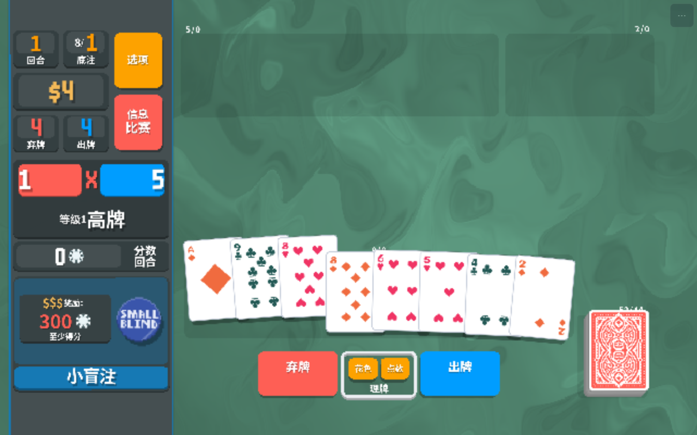
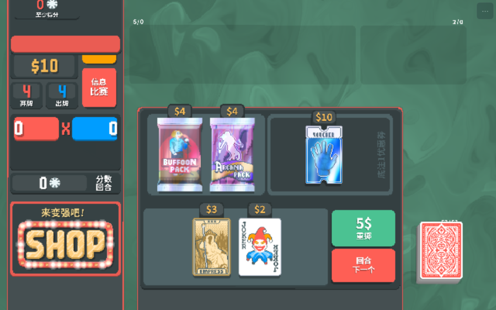

# Balatro（小丑牌）HTML5 网页版移植

> 由 `atb-game-porting` 技能移植 | 由 [fun.aitobox.com](https://fun.aitobox.com) 提供支持

本移植版在浏览器中**直接运行原版游戏的 Lua 代码**（游戏逻辑、UI 系统、计分结算、全部 150 张小丑牌、商店、盲注、塔罗/星球/幽灵卡、多语言……）。项目为浏览器编写了一层 LÖVE 11 API 替代层（WebGL2 渲染器、Web Audio 音频引擎、基于 `localStorage` 的虚拟文件系统、输入系统），替代原生 LÖVE 运行时。游戏玩法没有任何重新实现或猜测——网页上跑的就是原版游戏本体。



## 目录结构导航

- [快速开始](#-快速开始)
- [功能特性](#-功能特性)
- [技术架构](#-技术架构)
- [与原版的差异（诚实清单）](#-与原版的差异诚实清单)
- [工程目录](#-工程目录)
- [移植归属与 AI 模型信息](#-移植归属与-ai-模型信息)
- [原始游戏信息](#-原始游戏信息)
- [版权声明](#-版权声明)

## 🚀 快速开始

```bash
# 1) 克隆本仓库
git clone https://github.com/ns2250225/Balatro.git
cd Balatro

# 2) 启动静态服务器（HTTP 方式，推荐）
python -m http.server 8765
#    打开 http://localhost:8765/web/index.html
```

也可以**直接双击 `web/index.html`**（`file://` 协议）：图片、着色器与 Lua 均已打包为脚本加载，音效会自动降级为 `HTMLAudioElement` 播放，游戏照常可玩。

浏览器要求支持 WebGL2（主流桌面/移动浏览器均已支持）；无 WebGL2 时自动降级为 Canvas2D 渲染，不会黑屏。

`?atb_verify_stage=initial|gameplay|stage2` 参数会用原版游戏入口（`start_run` / `select_blind` / 出牌 / `cash_out`）自动驱动到对应场景，仅用于自动化验证。

## ✨ 功能特性

- **原汁原味**：完整保留原版 Lua 代码，150 张小丑牌、30 个盲注、24 个标签、299 个物品原型全部可用
- **原版视效**：19 个原版 GLSL 着色器在 WebGL2 中原样运行（foil / holo / polychrome / negative 卡面、溶解、背景漩涡等）
- **多语言**：保留原版全部 15 种语言的游戏内热切换（含简体中文）；首次启动按浏览器语言自动选择
- **存档持久化**：原版存档写入 `localStorage`；工具栏 ⬇/⬆ 一键导出/导入 JSON 存档（带 `game_id` 校验，失败不覆盖原存档），导入后无需刷新页面即可软重启生效，可用于跨设备同步
- **全端适配**：响应式布局 + 安全区适配，触摸自动映射为鼠标操作（支持手机/平板竖竖横横任意方向），竖屏时提示旋转
- **音频完备**：80 个原版音效与 5 轨循环配乐，按共享时钟同步淡入淡出；首次手势自动解锁音频

## 🛠 技术架构

| 项 | 说明 |
|---|---|
| 运行方式 | 浏览器内用 Lua 虚拟机运行**原版 Lua**；渲染为 WebGL2 画布（19 个原版着色器原样运行，含 foil/holo/polychrome/negative 卡面效果、溶解、背景漩涡）。无 WebGL2 时自动降级为 Canvas2D 渲染，不会黑屏 |
| 第三方代码 | **唯一的第三方运行时是 [fengari](https://fengari.io)（MIT 协议，Lua 5.3 的 JS 实现）**，随项目以补丁后的单文件 `src/lib/fengari.min.js` 提供。运行原版 Lua 必须有一个 Lua VM。补丁内容见下 |
| fengari 补丁 | ① 整数 `+ - *` 不再 32 位回绕（大分数不会变负）；② 浮点整数值按 Lua 5.1 风格打印（`12` 而非 `12.0`）；③ 用 `= undefined` 替代 `delete stack[i]`，逻辑耗时约降为 40%；④ `math.randomseed` 原实现用 `x\|0` 截断种子，原版用 (0,1) 小数播种，导致所有随机数完全相同、商店生成死循环（提现后卡死），改为对 double 位模式哈希 + mulberry32；⑤ **`pairs` 数组遍历顺序**：fengari 按哈希链序遍历，小数组会倒序（LuaJIT 按索引正序），导致 UI 兄弟节点布局乱序——卡包打开后卡区被排到屏幕外（卡包内无卡、跳过按钮被禁用不可点）。已在 `love.lua` 中覆盖全局 `pairs`：精确数组（键恰为 1..n）按索引正序迭代，其余表保持引擎序；另在 `patches.lua` 中将 `UIBox:set_parent_child` 的节点遍历改为**按索引跳过 nil 空洞的顺序遍历**（不能用 `ipairs`——UI 定义数组常含中途 nil 空洞，如选项菜单 `contents` 与主菜单语言按钮列，`ipairs` 会在第一个空洞处中断，导致语言切换按钮与「统计数据/定制牌组/制作人员」整批消失） |
| 音频方案 | HTTP 环境：Web Audio（一次解码、多声部、变速变调）；`file://` 环境：自动降级为池化 `HTMLAudioElement`；配乐用 `HTMLAudioElement` 流式播放并按共享时钟同步五轨淡入淡出；首次手势解锁；音效后台限流预热（并发 ≤ 3），其余懒加载 |
| 多语言 | 保留原版全部 15 种语言的游戏内热切换（涵盖 `en` / `zh-CN` / `ja` / `fr` / `de` / `es`）；首次启动按 `navigator.language` 自动选择；页面工具栏文字提供 6 语言 |
| 存档与跨端同步 | 原版存档（设置、配置文件、进度、跑局）写入 `localStorage`（命名空间 `atb_balatro_fs:`，`try/catch` + 内存降级）。工具栏 ⬇/⬆ 导出/导入 JSON（`game_id: "atb_balatro"` 校验，失败保持原存档），导入后**无需刷新页面**，直接软重启 Lua VM |
| 多端响应式 | `100dvh` + 安全区 inset；原版 `love.resize` 做等比信箱化；`touch-action: none`；触摸映射为鼠标事件（原版触屏流程）；所有工具按钮 ≥ 44px；竖屏时提示旋转 |
| 平台彩蛋 | 控制台 Banner；工具栏 `🎮 fun.aitobox.com` 徽章；连点徽章 3 次或点 ℹ 弹出本地化彩蛋/关于面板，链接至 `https://fun.aitobox.com` |



## ⚠️ 与原版的差异（诚实清单）

- Steam 成就 / 云存档 / 统计、崩溃上报、HTTP 排行榜：禁用
- 窗口模式、分辨率、垂直同步设置与「退出」按钮：隐藏（不适用于网页）
- CRT 后处理扭曲着色器：未启用（其余 18 个着色器与顶点着色器均正常运行）
- 整数运算在 2^53 以上退化为浮点（原版 LuaJIT 全为 double，结果一致）
- 性能：纯 Lua VM 在 JS 中运行。桌面浏览器上逻辑约 15–20 ms/帧，GPU 提交很小；低端设备可能低于 60 FPS（游戏逻辑基于 dt，速度不变，仅动画帧率降低）

## 📁 工程目录

```
Balatro/
├── README.md
├── analysis/            逆向分析报告（reverse_engineering_report.md、self_audit.md）与验证截图
├── assets/
│   ├── lua_bundle.js    原版 Lua 源码 + 运行时 shim（atb/*.lua）
│   ├── data/            P_CENTERS 等 JSON、6 语言本地化 JSON（分析产物）+ data.js
│   ├── images/          全部 2× 精灵图（32 位 RGBA PNG），images_data.js 为 data-URI 打包
│   ├── sounds/          80 个原版 OGG
│   ├── shaders.js       19 个原版 .fs 着色器
│   └── fonts/           m6x11plus（data-URI）
├── src/
│   ├── lib/fengari.min.js
│   ├── host/            lua_bridge.js、core.js（虚拟文件系统）、gfx_gl.js、gfx_text.js、gfx_2d.js、audio.js
│   ├── lua/             love.lua（LÖVE API shim）、patches.lua、verify.lua
│   ├── main.js          运行时、输入、主循环
│   └── ui.js            工具栏、存档导出/导入、彩蛋、错误面板
├── web/                 index.html（引用 assets 与 src）
└── dist/                构建产物（release zip / standalone html，不入库，可由移植工作区重新生成）
```

> 资源重建工具链（`extract_data.py` / `build_assets.py` / `build_lua_bundle.py` / fengari 打补丁脚本 / 无头冒烟测试等）位于移植工作区 `tools/` 目录，未包含在本仓库；仓库内的 `assets/` 已是完整可运行的打包产物。重新生成资源需要原版 `Balatro.exe`（按 ZIP 解包）作为输入。

## 🧬 移植归属与 AI 模型信息

| 项 | 说明 |
|---|---|
| 驱动模型 (AI Model) | Claude Sonnet 5.5（Anthropic） |
| 开发工具链 (Agent Harness & RE Tools) | Claude Code（VS Code 扩展）；逆向方式：直接解包 ZIP + Lua 源码级分析（`lupa` 执行数据表），`reverse-engineer-anything` / Hopper 在本环境不可用且不需要 |
| 执行技能版本 (Skill Version) | `atb-game-porting v1.0.0` |
| 移植完成时间 | 2026-10-22 |
| 平台背书 | [fun.aitobox.com](https://fun.aitobox.com) |

## 🎴 原始游戏信息

- **游戏名称**：Balatro（小丑牌）
- **开发与发行商**：LocalThunk（开发）/ Playstack（发行），2024
- **类型**：扑克牌构筑 roguelike（poker-hand deck-builder）
- **原始平台与架构**：Windows，LÖVE 11.x（LuaJIT）fused 可执行文件——Lua 源码以 ZIP 形式附在 PE 外壳之后；Steam 集成（`luasteam`）
- **原始规模与体积**：
  - `Balatro.exe` 56 MB（LÖVE 运行时 + 304 个打包文件）
  - 约 3.4 万行 Lua、150 张小丑牌、30 个盲注、24 个标签、299 个物品原型
  - 2× 精灵图集（8BitDeck / Jokers / Tarots / Enhancers / Vouchers / boosters / BlindChips 等）、19 个 GLSL 着色器、15 种语言
  - 原始音频：80 个 OGG（音效 + `music1-5` 循环配乐 + 环境音）

## ©️ 版权声明

原作《Balatro》版权归 **LocalThunk / Playstack** 所有。本仓库包含其代码与美术/音频资源，仅可在拥有版权或获得明确授权（请求移植者已声明具备）的前提下分发；请勿在无授权的情况下公开发布。
